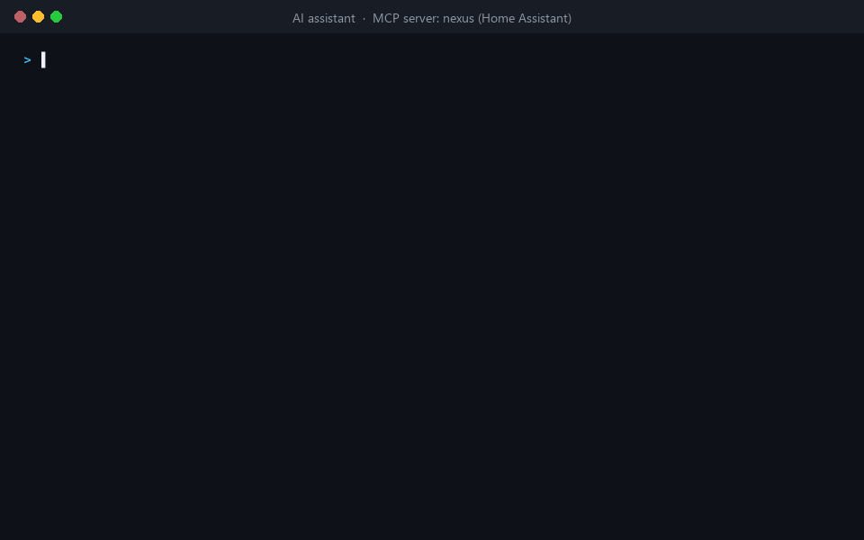

<div align="center">


# Nexus Agent — MCP for Home Assistant

**Let your AI assistant build, fix and run your Home Assistant — dashboards, automations, energy, ESPHome and more.**<br>
354 tools across 32 domains · Home Assistant add-on or Docker · MIT

[](https://github.com/Fistacho/ha-nexus-agent/releases/latest)
[](https://github.com/Fistacho/ha-nexus-agent#installation--home-assistant-add-on-recommended)
[](https://github.com/Fistacho/ha-nexus-agent#manual-installation-add-on-store)
[](LICENSE)
[](https://github.com/Fistacho/ha-nexus-agent/stargazers)

Works with **Claude Code**, **Claude Desktop**, **VS Code (Copilot)**, **Cursor**, **Windsurf**, **OpenAI Codex CLI**, **Gemini CLI** — any MCP client.

</div>



<sub>Illustration of a typical session. Tool names, parameters and result shapes are nexus' real API; the entities and the dashboard are generic, not a real home.</sub>

**Latest release: v0.29.0** — Node-RED and NeonPlan 3D tools, `entities_remove_entity`, fixes. [Release notes](CHANGELOG.md#0290) · [all releases](https://github.com/Fistacho/ha-nexus-agent/releases)

---

## Installation — Home Assistant Add-on (Recommended)

[](https://my.home-assistant.io/redirect/supervisor_add_addon_repository/?repository_url=https%3A%2F%2Fgithub.com%2FFistacho%2Fha-nexus-agent)

1. Click the button above to add the repository to Home Assistant.
2. Find **Nexus Agent** in the Add-on Store → **Install** → **Start**.
3. Click **Open Web UI**, copy the ready-made config for your AI client and paste it in ([details](#connecting-mcp-clients)).

Then ask: *"Give me a summary of my home — what's on, what's unavailable, what needs updating."*

- Want to look before it can change anything? Turn on **[read-only mode](#read-only-mode)** first.
- Home Assistant Container or Core (no add-ons)? See **[Run without the add-on (Docker)](#run-without-the-add-on-docker)**.

### Manual Installation (Add-on Store)

If the MY button does not work for your setup:

1. In Home Assistant go to **Settings → Add-ons → Add-on Store**
2. Click the three-dot menu (⋮) → **Repositories**
3. Add:

   ```text
   https://github.com/Fistacho/ha-nexus-agent
   ```

4. Find **Nexus Agent** → **Install** → **Start** → **Open Web UI**

The web UI shows your API key and generates ready-to-paste config for every MCP client.

---

## Connecting MCP Clients

Open Nexus with the **Open Web UI** button on the add-on's page (Settings → Add-ons → Nexus Agent) after starting it — that page shows your real API key and the exact, ready-to-paste config for every client below. This works over HA's ingress proxy whether or not you've also enabled **Show in sidebar** on that same add-on page — the sidebar entry is just a shortcut to the same URL. Outside of ingress (or without a valid `Authorization: Bearer` header), the same page hides the key.

The MCP endpoint is a **Streamable HTTP** transport (not SSE) at:

```text
http://your-ha-ip:7123/mcp
```

Authenticate with an `Authorization: Bearer YOUR_API_KEY` header. Since nexus **1.0.0** this is the only way: the old `?token=` query string no longer authenticates (a request that still uses it gets `401` with a hint).

### Claude Code CLI

```bash
claude mcp add nexus --transport http "http://your-ha-ip:7123/mcp" --header "Authorization: Bearer YOUR_API_KEY" --scope user
```

(`--transport http`, not `sse` — Nexus speaks Streamable HTTP. Syntax per the [Claude Code MCP docs](https://code.claude.com/docs/en/mcp).)

### VS Code

Create `.vscode/mcp.json`:

```json
{
  "servers": {
    "nexus": {
      "type": "http",
      "url": "http://your-ha-ip:7123/mcp",
      "headers": {
        "Authorization": "Bearer YOUR_API_KEY"
      }
    }
  }
}
```

### Cursor

Add to `~/.cursor/mcp.json`:

```json
{
  "mcpServers": {
    "nexus": {
      "url": "http://your-ha-ip:7123/mcp",
      "type": "http",
      "headers": {
        "Authorization": "Bearer YOUR_API_KEY"
      }
    }
  }
}
```

<details>
<summary><b>Claude Desktop, Gemini CLI, OpenAI Codex CLI, Windsurf</b></summary>

### Claude Desktop

Add to `%APPDATA%/Claude/claude_desktop_config.json` (Win) or `~/Library/Application Support/Claude/claude_desktop_config.json` (Mac):

```json
{
  "mcpServers": {
    "nexus": {
      "command": "python",
      "args": ["server.py"],
      "cwd": "/path/to/ha-nexus-agent",
      "env": {
        "HA_URL": "http://homeassistant.local:8123",
        "HA_TOKEN": "your_ha_token_here"
      }
    }
  }
}
```

### Gemini CLI

```bash
gemini mcp add --transport http --header "Authorization: Bearer YOUR_API_KEY" nexus "http://your-ha-ip:7123/mcp"
```

### OpenAI Codex CLI

Codex reads the key from an environment variable and sends it as `Authorization: Bearer`:

```bash
export NEXUS_API_KEY="YOUR_API_KEY"   # keep this in your shell profile
codex mcp add nexus --url "http://your-ha-ip:7123/mcp" --bearer-token-env-var NEXUS_API_KEY
```

That writes the same entry you could add to `~/.codex/config.toml` by hand:

```toml
[mcp_servers.nexus]
url = "http://your-ha-ip:7123/mcp"
bearer_token_env_var = "NEXUS_API_KEY"
```

### Windsurf

Add to `~/.codeium/windsurf/mcp_config.json`:

```json
{
  "mcpServers": {
    "nexus": {
      "url": "http://your-ha-ip:7123/mcp",
      "type": "http",
      "headers": {
        "Authorization": "Bearer YOUR_API_KEY"
      }
    }
  }
}
```

</details>

> **Tip:** Copy the exact config with your real key from the **Open Web UI** button on the add-on's page (ingress). The same URL outside of ingress hides the key — see [Security](#security).

---

## What can you ask?

Once connected, just talk to your assistant. Some things people use nexus for:

**Everyday**

- *"Turn off every light downstairs and close the blinds."*
- *"Why is the bedroom sensor unavailable since yesterday?"*
- *"Which automations, scripts and Node-RED flows use `binary_sensor.front_door`?"*

**Build**

- *"Build me a living room card with temperature, lights and the blinds — then show me a screenshot."*
- *"Create an automation: notify me if the garage door is open after 10 PM. Lint it and check every entity exists before saving."*
- *"Make a dark theme with orange accents and set it as default."*

**Energy & history**

- *"How much energy did we use per day last week, compared to the week before?"*
- *"Add my solar inverter and battery to the Energy dashboard."*

**Maintenance**

- *"What updates and repairs are pending? Summarise them by risk."*
- *"Compile the kitchen ESPHome display, flash it over the air and show me its logs."*
- *"Checkpoint my config in git, then clean up unused entities and orphaned devices."*

---

## Why nexus?

- **One small tool per action — 354 of them.** Each tool does one thing, has typed parameters and a
  description written for models (`Use when` / `Not for` / `Returns`). Clients that load every tool up
  front can switch to `tool_mode: search`: a BM25 tool search plus call-by-name proxies, 6 tools in
  `tools/list` instead of the full catalogue.
- **Safe by default, opt-in for the risky parts.** Server-wide [read-only mode](#read-only-mode),
  `disabled_namespaces`, writes that run code (Node-RED flows) off until you enable them,
  [`confirm=True` gates](#confirmation-gates) on 18 tools, stale-read guards (`config_hash`) on dashboard
  section edits, restore points before Node-RED and NeonPlan changes, git checkpoints of `/config`.
- **Beyond the core APIs.** ESPHome compile / validate / OTA and LVGL display widgets, Node-RED flows,
  AdGuard Home DNS and filter lists, the Supervisor (add-ons, backups), long-term statistics, live
  WebSocket subscriptions, NeonPlan 3D house plans and a 38-tool Card Builder.
- **It can see what it built.** `dashboards_screenshot` renders any view to PNG, so the assistant checks
  its own dashboard work instead of guessing.
- **Every tool is annotated and tested.** Read / write / destructive hints follow a written contract
  (ADR-0002) checked by the test suite, so clients can auto-approve reads and ask before writes.

### How it compares

Other good options exist — pick the one that fits. Compared on 2026-11-21 from each project's own
README; corrections are welcome in [Discussions](https://github.com/Fistacho/ha-nexus-agent/discussions).

| | **nexus** | [ha-mcp](https://github.com/homeassistant-ai/ha-mcp) | [HA Vibecode Agent](https://github.com/Coolver/home-assistant-vibecode-agent) | [HA built-in MCP Server](https://www.home-assistant.io/integrations/mcp_server/) |
| --- | --- | --- | --- | --- |
| Runs as | Add-on, or Docker image | HACS integration (in-process, any install type), add-on, Docker, `uvx` | Add-on or Docker, plus an npm MCP package on your computer | Built into Home Assistant |
| Scope | Whole instance + Supervisor | Whole instance | Whole instance | Entities exposed to Assist |
| Tool style | 354 single-purpose tools | 86 tools, many multi-action (`ha_manage_*`) | ~100 tools | Assist intents |
| Automations, scripts, scenes | ✅ CRUD, traces, linter, reference check | ✅ | ✅ | ❌ |
| Create helpers | ❌ (set values only) | ✅ | ✅ | ❌ |
| Dashboards | Section-aware edits with `config_hash`, resources, screenshots, Card Builder; no create/delete | Create/delete, JSON-Patch edits with `config_hash`, auto-backup, screenshots (beta) | Cards, layouts, themes | ❌ |
| Read-only / limits | Server-wide `read_only`, `disabled_namespaces`, opt-in code-running writes | Read Only Mode, **per-connection `/readonly` URL**, per-tool toggles, approval policies | Not documented | Only what you expose to Assist |
| Undo | `confirm` gates, git checkpoint + rollback, restore points | Automatic backup before edits | Git commit of every change in a separate repo | — |
| Also has | ESPHome + LVGL, Node-RED, AdGuard Home, statistics, WebSocket subscriptions | Z-Wave / ZHA / Matter, OAuth / OIDC, Agent Skills, tool search | Deploy workflow for hand-written YAML | Nothing to install |

**Where the others are ahead:** ha-mcp has a much larger community, a read-only URL per connection
(nexus' `read_only` applies to the whole server), dashboard create/delete with automatic backups,
OAuth/OIDC, and installs as an integration on every Home Assistant install type. Vibecode Agent
commits every change to its own git repository automatically and can create helpers. The built-in
MCP Server needs no install at all and is the right choice if you only want voice-style control.

---

## Read-only mode

The safest way to try nexus: the AI can read everything and change nothing. Set the add-on option `read_only: true` (then restart), or `NEXUS_READ_ONLY=true` when running standalone. Every tool that is not annotated read-only, including generic service calls, is hidden from `tools/list` and refused if called by name; the server enforces this, not the client. 169 of 354 tools stay. The startup log shows `Tool policy applied: read_only=True …`. It limits changes, not reading: combine it with `disabled_namespaces` (e.g. `files,git,supervisor`) to narrow what can be read. [More](DOCS.md#read-only-mode).

Even with `read_only: false`, the writes that run arbitrary code stay off until you opt in: `nodered_write_enabled` for Node-RED flows ([Node-RED](#node-red)) and `addon_exec_options_enabled` for other add-ons' options that run code ([Security](#security)). All options: [Add-on Options](#add-on-options).

---

## Run without the add-on (Docker)

For Home Assistant Container or any HA reachable over the network. You need a long-lived access token (HA → Profile → Security → Long-Lived Access Tokens). Use an HA address reachable from inside the container (an IP is safest).

**stdio** — your MCP client starts the container itself:

```json
{
  "mcpServers": {
    "nexus": {
      "command": "docker",
      "args": ["run", "-i", "--rm", "-e", "HA_URL", "-e", "HA_TOKEN", "-e", "NEXUS_READ_ONLY",
               "ghcr.io/fistacho/nexus-agent:1.0.0"],
      "env": { "HA_URL": "http://192.168.1.10:8123", "HA_TOKEN": "your_long_lived_token", "NEXUS_READ_ONLY": "true" }
    }
  }
}
```

That is Claude Desktop's `claude_desktop_config.json`; VS Code's `.vscode/mcp.json` uses the same entry under `"servers"`. Claude Code:

```bash
claude mcp add nexus -e HA_URL=http://192.168.1.10:8123 -e HA_TOKEN=your_long_lived_token -e NEXUS_READ_ONLY=true \
  -- docker run -i --rm -e HA_URL -e HA_TOKEN -e NEXUS_READ_ONLY ghcr.io/fistacho/nexus-agent:1.0.0
```

**HTTP** — one long-running server for several clients (`NEXUS_HTTP=1` is required; without it the container runs stdio and exits when started with `-d`):

```bash
docker run -d --name nexus --restart unless-stopped -p 7123:7123 \
  -e NEXUS_HTTP=1 -e HA_URL=http://192.168.1.10:8123 -e HA_TOKEN=your_long_lived_token \
  -e NEXUS_API_KEY=$(openssl rand -hex 32) \
  ghcr.io/fistacho/nexus-agent:1.0.0
```

Connect to `http://<docker-host>:7123/mcp` with `Authorization: Bearer <NEXUS_API_KEY>`. Mount your HA config folder (`-v /path/to/config:/config`) to use the file/git tools. Tools that need the Supervisor (`supervisor_*`, add-on discovery) return an error in standalone mode. Details, env vars and `uvx`: [DOCS.md](DOCS.md#running-without-the-add-on-docker--ha-container).

`1.0.0` is the release this README describes; any tag from the [releases page](https://github.com/Fistacho/ha-nexus-agent/releases), or `latest`, works the same way.

### Standalone (outside HA)

Without Docker, from a clone of the repository:

```bash
git clone https://github.com/Fistacho/ha-nexus-agent
cd ha-nexus-agent
pip install -r requirements.txt
cp .env.example .env
# Edit .env: set HA_URL and HA_TOKEN
python server.py               # stdio: point your MCP client's "command" at this
NEXUS_HTTP=1 python server.py  # or HTTP on port 7123
```

In HTTP mode, open <http://localhost:7123> on the same machine to get your API key and MCP client configs (the Setup UI trusts only localhost outside the add-on).

#### Getting a Home Assistant token

1. In HA: **Profile → Security → Long-Lived Access Tokens**
2. **Create Token** → name it `nexus`
3. Paste as `HA_TOKEN` in `.env` (or pass it with `-e HA_TOKEN`)

### Docker Image

The image is `ghcr.io/fistacho/nexus-agent`, signed with cosign since 0.25.0. `run.sh` detects the absence of `/data/options.json` (only present under the real Supervisor) and reads `HA_URL`/`HA_TOKEN` and the `NEXUS_*` variables from the environment instead. Verify the signature before trusting a pulled image:

```bash
cosign verify --certificate-oidc-issuer https://token.actions.githubusercontent.com \
  --certificate-identity-regexp '^https://github\.com/Fistacho/ha-nexus-agent/' \
  ghcr.io/fistacho/nexus-agent:1.0.0
```

The add-on itself (config.yaml's `image:`) points at this exact same
multi-arch manifest tag — Supervisor picks the right architecture at pull
time regardless of the image *name* (an explicit `platform=` argument to the
Docker Engine pull itself), so no per-architecture image name is needed. Only
`aarch64` and `amd64` are published as of 0.25.0 (see
[CHANGELOG.md](CHANGELOG.md#0250) — HA itself dropped Core/Supervised support
for 32-bit hosts in 2025.12, and the build tooling this repo uses for signed
images has no supported path to add `armhf`/`armv7`/`i386` back). Everyone on
those architectures keeps working on 0.24.x, which still builds locally via
the Dockerfile, but cannot update past it.

`server.json` in this repo declares this same image as an
[MCP Registry](https://modelcontextprotocol.io/registry) OCI package (stdio,
`HA_URL`/`HA_TOKEN` required, `NEXUS_READ_ONLY`/`NEXUS_DISABLED_NAMESPACES`
optional); nexus is listed in the registry from 1.0.0 (ADR-0005). Full
operational details (options, security posture, ESPHome): [DOCS.md](DOCS.md).

---

## Tools

354 tools across 32 categories:

<details>
<summary><b>All 32 namespaces and what they do</b></summary>

| Category | Tools | Highlights |
| --- | --- | --- |
| `entities_*` | 19 | list (paginated + field selection), turn on/off/toggle, **bulk_control**, voice expose, set_value, **remove orphaned entity** |
| `services_*` | 19 | call_service (**`confirm` gate** on 8 guarded services — restart/stop/host reboot/host shutdown/restore backup/`update.install`/`group.remove`, see [Confirmation Gates](#confirmation-gates)), notify, light color, camera snapshot/record, media controls |
| `automations_*` | 31 | CRUD + full YAML, traces, scripts, scenes, **scene CRUD** (`get/set/delete_scene_config`), **validate_best_practices** (static linter), **validate_automation_references** (live registry check), **list/set/remove groups**, confirm gates on delete |
| `blueprints_*` | 5 | list, import from URL, **save** (persist imported YAML), delete, instantiate |
| `areas_*` | 9 | list, create, **update** (rename, icon, floor, aliases), delete, get_states, **control_area** |
| `devices_*` | 4 | list, update (rename/move/disable), remove |
| `calendar_*` | 4 | list calendars/events, create/delete event |
| `todo_*` | 5 | list, add/update/remove items |
| `helpers_*` | 11 | input_boolean/number/text/select/datetime, timers, counters |
| `history_*` | 5 | state history, logbook, error log, system info |
| `system_*` | 12 | check_config, backup, **restart/stop** (confirm gate), **get_updates**, **get_system_health**, **get_repairs** |
| `dashboards_*` | 15 | get/save config, add cards/views, **section-aware editing** of `type: sections` views (list sections, add/update/remove cards in a section, add section), **screenshot** (Puppet), **add/remove/update resources** (JS/CSS) |
| `files_*` | 6 | read/write config files, YAML validation (`!include`, `!secret`) |
| `git_*` | 11 | commit, **rollback** (confirm gate), log, **safe_write_with_checkpoint** |
| `ws_*` | 7 | listen state changes, events, subscribe_trigger, render_template |
| `supervisor_*` | 20 | add-on install/start/stop/update/logs/stats, backups, core/host info |
| `hacs_*` | 7 | list/install/uninstall/update repos via the built-in **Marketplace** (HA 2026.11+) or HACS (older HA), pending upgrades |
| `energy_*` | 9 | grid, solar, battery sources, energy preferences |
| `zones_*` | 8 | create/update/delete zones, person location |
| `labels_*` | 14 | labels, categories, assign to entities/devices |
| `search_*` | 7 | fuzzy search, orphan devices, unused entities, deep_search |
| `integrations_*` | 13 | **config_flow** (install like in UI), options flow CRUD, enable/disable, **remove** (confirm gate) |
| `voice_*` | 10 | Assist pipelines CRUD, STT/TTS/wake-word engines |
| `themes_*` | 8 | list/create/update/delete Lovelace themes |
| `card_builder_*` | 38 | Cards CRUD, style presets, CSS properties, media, renderer config, **embedded block schema** (`list_block_types`, `get_block_schema`, `list_button_toggle_features`), **embedded styles knowledge** (`list_style_categories`, `list_style_targets`, `list_style_snippets`, `build_styles`), **10 turnkey templates** (`make_template_card`), **`build_from_recipe`** high-level builder, **`validate_config`**, **`check_schema_sync`**, upload SVG/media/image-from-url, design patterns, design principles |
| `snapshot_*` | 2 | **Aggregated one-call context** — states + areas + devices + entities + integrations, domain/area/field filters, pagination |
| `esphome_*` | 18 | list devices + online status, **read / write** config YAML, get entities, **compile / validate / OTA upload** via Dashboard API, add-on logs, ping; **LVGL**: list LVGL devices, get pages/widgets/styles, **client-side validate** (unique IDs, page refs), add/delete widgets |
| `statistics_*` | 4 | **long-term recorder statistics** — list IDs, get sum/mean/min/max by hour/day/week/month, **`get_energy_statistics`** (auto-discovers kWh/m³ sensors) |
| `adguard_*` | 6 | **AdGuard Home add-on**: `get_config` (status, DNS, filters, safe search, access lists), `set_dns_config` (allowlisted DNS fields, upstreams tested before writing), `check_host` (which rule/list filters a domain), **filter lists**: `add_filter` (waits up to 180 s, works for lists too large for HA's `adguard.add_url`), `remove_filter`, `set_filter_enabled` |
| `nodered_*` | 12 | **Node-RED add-on**: `list_flows`, `get_flow` (secrets hidden), `search_nodes`, **`find_entity_usage`** (which flows use an HA entity), `get_info` (version, palette modules), `get_diagnostics`; `list_backups`; **writes (opt-in `nodered_write_enabled`) with automatic backup and rev conflict check**: `create_flow`, `update_flow`, `delete_flow`, `set_flow_enabled`, `restore_backup` |
| `neonplan_*` | 11 | **NeonPlan 3D integration**: `get_status`, `list_plans`, `get_plan`, **`validate_plan`** (references, HA areas/entities), **`suggest_bindings`**, `list_restore_points`; **writes with validation, restore point and revision check**: `save_plan`, **`patch_plan`** (JSON Patch), `create_restore_point`, `restore_restore_point`, `upload_background_image` |
| `discover_*` | 4 | **BM25 tool search** — query the tool catalogue, list namespaces, fetch full docstrings |

</details>

Ask the server itself: `discover_list_namespaces`, `discover_tool_search("query")` and `discover_get_tool_doc` return the live catalogue with full descriptions.

---

## Features

- **354 MCP tools** across 32 categories, one action per tool
- **Built-in tool search** — `discover_tool_search("query")` finds the right tool without flooding the AI's context
- **Confirmation gates** — 18 destructive tools, plus 8 guarded services reachable via `services_call_service`, require `confirm=True`; without it they return the exact command to re-run. See [Confirmation Gates](#confirmation-gates).
- **Automation linter** — `automations_validate_best_practices` catches 7 common YAML mistakes before they cause issues
- **Live reference validator** — `automations_validate_automation_references` cross-checks every entity_id and service call against the running HA instance
- **Updates monitor** — `system_get_updates` lists all pending updates across core, add-ons and HACS
- **Repair issues** — `system_get_repairs` surfaces active issues from HA's repair centre
- **Lovelace resources** — add/remove/update custom JS modules and CSS without editing YAML
- **Dashboard screenshot** — render any Lovelace view to PNG via the Puppet engine (see below)
- **Real-time WebSocket** — subscribe to state changes, events and triggers live
- **Git versioning** — commit `/config`, checkpoint before a risky write (`git_safe_write_with_checkpoint`), rollback behind a confirm gate
- **YAML validation** before writing any config file (`!include`, `!secret` aware)
- **Setup web UI** — generates ready-to-use MCP config for every client
- **HA Add-on native** — one-click install, no manual token setup
- **API key auth** — `/mcp` requires the key as an `Authorization: Bearer` header
- **Ingress-gated Setup UI** — the API key and one-click client config are only shown to Home Assistant's ingress proxy or a valid Bearer token; see [Security](#security)

---

## Security

- **Setup UI (`GET /`) and `POST /regenerate`** only reveal the API key / accept a key reset from callers Home Assistant has already authenticated:
  - via the **HA ingress proxy** (the **Open Web UI** button on the add-on's page, or the Nexus sidebar entry if you've enabled **Show in sidebar**) — this is the intended way to open Nexus;
  - via a valid `Authorization: Bearer <API_KEY>` header — for scripted/CLI access;
  - in **standalone mode only** (no Supervisor, e.g. `.env` deployment) — from `localhost`, since there is no ingress proxy to authenticate the caller there.

  Any other caller gets the page with the key, tool count and active policy omitted (or `403` for `/regenerate`).
- **`GET /health` is intentionally unauthenticated and minimal** — it returns only `{"status": "ok"}`, nothing else, because the Supervisor watchdog that polls it only needs a 200 response. The tool count, `ha_url` and active `read_only`/`disabled_namespaces` policy used to leak here to anyone on the LAN; they now live only on the ingress-gated Setup UI page above.
  - The Supervisor **Watchdog** itself is **off by default** and must be turned on with the **Watchdog** toggle on the add-on's **Info** tab — listing `watchdog:` in the add-on's own manifest does not enable it by itself.
- **`/mcp` accepts only `Authorization: Bearer <API_KEY>`**. The `?token=<API_KEY>` query string was removed in nexus 1.0.0 because it ended up in HTTP access logs and shell/browser history; see [Connecting MCP Clients](#connecting-mcp-clients) for every client's header config.
- **Access logs never contain the raw key** — a client still sending a pre-1.0.0 `?token=...` URL is rejected, and the add-on redacts that value in uvicorn's access log before it's written.
- **Startup logs never print the raw key** — only the path of the file it's stored in (`/config/.nexus_api_key`).
- **Tool-exposure policy** (`read_only`, `disabled_namespaces`) — see [Add-on Options](#add-on-options) — narrows what a client can see/call at the MCP protocol level itself: a hidden tool is refused at `tools/call`, not merely omitted from `tools/list`. `read_only` does not restrict what an already-visible read tool can read (e.g. `files_read_config_file`, `git_log`, `supervisor_get_addon_logs`); combine with `disabled_namespaces` to also narrow that.
- **Add-on options that run code are opt-in** (ADR-0008). By default `supervisor_set_addon_options` refuses to add, change or remove another add-on's option whose name (at any depth) says it runs code — commands, scripts, packages, plugins, environment variables, `authorized_keys` — on every add-on, not only those with the Supervisor `manager` role. Such code would run with that add-on's privileges, and a `manager` add-on can change nexus's own options. Turn on `addon_exec_options_enabled` only if you trust whoever drives nexus that far. The check is by key name: an option that runs code under an innocent name (for example a free-text socat address) is not caught.
- Found a vulnerability? See [SECURITY.md](SECURITY.md) for how to report it privately.

---

## Confirmation Gates

`confirm` is a human-in-the-loop checkpoint, not a security boundary — it
stops an AI assistant from running a disruptive action without the caller
explicitly asking twice; it does not stop a script, automation, YAML file +
reload, blueprint, `services_fire_event` or `button.press` from reaching the
same effect indirectly (an accepted residual risk — the indirect paths run
inside HA Core's own automation engine, outside anything nexus mediates).
The actual security boundary is [`read_only`/`disabled_namespaces`](#add-on-options),
which hides the tool (or the guarded services below) entirely.

18 tools require `confirm=True` before they do anything:

| Tool | Effect gated |
| --- | --- |
| `system_restart_ha` | restarts HA Core |
| `system_stop_ha` | stops HA Core |
| `supervisor_restart_core` | restarts HA Core |
| `supervisor_restart_host` | reboots the host |
| `supervisor_restore_backup` | restores a full backup, discarding changes since |
| `supervisor_delete_backup` | permanently deletes a backup |
| `supervisor_uninstall_addon` | deletes an add-on and its data |
| `automations_delete_automation` | deletes an automation config |
| `automations_delete_script` | deletes a script config |
| `automations_remove_group` | removes an automation/script group |
| `automations_delete_scene` | deletes a scene config |
| `dashboards_remove_dashboard_resource` | removes a Lovelace JS/CSS resource |
| `git_rollback_file` | reverts one file in `/config` to a prior commit |
| `git_rollback_to_commit` | reverts all of `/config` to a prior commit |
| `integrations_remove_integration` | removes a config entry |
| `files_delete_config_file` | deletes a file under `/config` |
| `esphome_upload_device` | flashes new firmware, no automatic rollback |
| `services_call_service` | **only** when `domain.service` is one of eight guarded services: `homeassistant.restart`/`stop`, `hassio.host_reboot`/`host_shutdown`/`restore_full`/`restore_partial`, `update.install`, `group.remove` — ignored for every other service |

`ws_call_service` never accepts `confirm` for those same eight guarded
services — it refuses them outright with `{"error":
"guarded_service_refused", "use": "services_call_service"}`, since none of
them return a response payload anyway.

---

## Add-on Options

| Option | Default | Description |
| --- | --- | --- |
| `log_level` | `info` | Add-on's own log verbosity (`debug`\|`info`\|`warning`\|`error`) |
| `api_key` | *(auto-generated)* | Pin the MCP API key instead of letting nexus generate one |
| `read_only` | `false` | Hide and refuse every tool that is not read-only (ADR-0003), and every MCP prompt. See [Security](#security) for what it does *not* restrict. Requires a restart. |
| `disabled_namespaces` | `[]` | List of tool namespaces (e.g. `["supervisor", "git"]`) to hide and refuse entirely. An unknown namespace name refuses to start with a readable error in the add-on log. Requires a restart. |
| `nodered_write_enabled` | `false` | Allow the five `nodered_*` write tools (create/update/delete/enable/restore flows). **Full trust**: a flow runs any code inside the Node-RED add-on, which holds a Supervisor token with the `manager` role and Node-RED's node secrets — see [Node-RED](#node-red) and ADR-0007. `read_only` still hides them. Requires a restart. |
| `addon_exec_options_enabled` | `false` | Allow `supervisor_set_addon_options` to add, change or remove other add-ons' options that run code on their next start: commands (`init_commands`), packages (`npm_packages`, `system_packages`, `python_packages`, `packages`), plugins, environment variables, SSH `authorized_keys`. Off, other options still change if those are sent back as read. **Full trust** when on (ADR-0008). Requires a restart. |
| `tool_mode` | `full` | `full` exposes every tool in `tools/list`, unchanged. `search` instead shows only 3 lookup tools (`discover_tool_search`, `discover_get_tool_doc`, `discover_list_namespaces`) plus 3 call-by-name proxies, one per tool class (`discover_call_read_tool` / `_write_tool` / `_destructive_tool`) — a much smaller catalogue for context-constrained clients. Every tool `search` hides still works if called directly by name, and stays subject to `read_only`/`disabled_namespaces` exactly as in `full` mode — this option only changes what `tools/list` shows. `discover` must stay out of `disabled_namespaces` while this is `search` (the add-on refuses to start otherwise — it would leave `tools/list` empty). Requires a restart. |

`read_only` and `disabled_namespaces` combine as a union — a tool hidden by either one is hidden. Both are evaluated once at startup; there is no per-session or per-client variant. `tool_mode` is a context-budget convenience, not a security boundary — it never widens or narrows what `read_only`/`disabled_namespaces` already decided.

## Network (add-on)

Since 0.23.0 the add-on runs with `host_network: true` (ADR-0004) — the only way it can
reach the ESPHome Device Builder add-on's trusted-peer ingress site at
`127.0.0.1:<its ingress_port>`, the same path Home Assistant Core itself uses to reach
it. This is a deliberate trade-off, not a default anyone should ignore: the add-on's
Supervisor security rating drops by one point as a result, since a host-networked
container can reach the host's own loopback interface, not just its own network
namespace.

Practically, Docker no longer publishes `ports:` from `config.yaml` — nexus reconstructs
your choice itself at startup from the add-on's **Network** tab (Configuration tab, or
Info tab → Network):

- **Default (`7123`)** — nexus binds `0.0.0.0:7123`; MCP + Setup UI are reachable on the
  LAN at that port, same as before 0.23.0.
- **Remapped to another port** — nexus binds the LAN socket there instead;
  `ingress_port` stays fixed at `7123` regardless, so Home Assistant's own ingress
  ("Open Web UI") keeps working either way.
- **Disabled/unmapped** — no LAN socket at all; only Home Assistant ingress can reach
  nexus. This is the only way to turn the LAN endpoint off entirely.

The Network tab is the only place to choose the LAN port. The `port` *option* that
existed before 1.0.0 did nothing since 0.23.0 and was removed.

## AdGuard Home

`adguard_*` tools work with the community **AdGuard Home** add-on (slug
`*_adguard`). That add-on runs AdGuard's API on `127.0.0.1:45158` with host
networking, the address Home Assistant's own `adguard` integration connects
to; nexus reaches it the same way thanks to `host_network: true` (above). No
extra add-on permission is needed: the Supervisor API is only used to find the
add-on and check it is started.

- `adguard_get_config` — read-only overview.
- `adguard_set_dns_config` — changes only the fields you pass, from a fixed
  allowlist. If upstream, fallback, bootstrap or PTR resolvers change, AdGuard's
  `test_upstream_dns` runs first and the write is refused unless every server
  answers `OK` (a domain-specific upstream reported as a warning also blocks it).
  Changes apply to every device using AdGuard as DNS immediately. Hidden in
  `read_only` mode.
- `adguard_check_host` — which rule and filter list match a domain.
- `adguard_add_filter` — adds a blocklist or allowlist by `https://` URL and
  waits up to 180 s for AdGuard to download and parse it (HA's
  `adguard.add_url` service stops after 10 s, so large lists fail there). A
  URL already on either list returns `already_exists` and nothing is sent.
- `adguard_remove_filter` — removes one list by its exact URL (`not_found`
  if it is not on that list).
- `adguard_set_filter_enabled` — turns one list on or off, keeping its name
  and URL; enabling waits up to 180 s for the download.
- The three filter tools are hidden in `read_only` mode. Refreshing lists
  stays with HA's `adguard.refresh` service.

If you added a web login in AdGuard Home itself, these tools return
`adguard_auth_required`. Standalone installs (no Supervisor) are not supported.

## Node-RED

`nodered_*` tools work with the community **Node-RED** add-on (slug
`*_nodered`). That add-on starts Node-RED with its Admin API on
`127.0.0.1:46836` and login turned off there (Home Assistant's ingress and
the add-on's own nginx handle login in front of it); nexus reaches that
address thanks to `host_network: true` (above). No Home Assistant password
or extra permission is needed: the Supervisor API is only used to find the
add-on and check it is started.

> **Writing flows is off by default.** The five write tools stay hidden
> (and refused if called) until you turn on the add-on option
> **`nodered_write_enabled`** and restart nexus. Turning it on means full
> trust in whoever drives nexus: a deployed flow runs any code inside the
> Node-RED add-on, which holds a Supervisor token with the `manager` role
> (it can, for example, change nexus's own options and lift `read_only`)
> and can read the secrets stored in Node-RED's nodes (`credential_secret`,
> `flows_cred.json`). nexus's own guards (self-protection, `read_only`) do
> not reach code running inside Node-RED. ADR-0007.

- `nodered_list_flows`, `nodered_get_flow`, `nodered_search_nodes`,
  `nodered_get_info`, `nodered_get_diagnostics` — read-only.
- `nodered_find_entity_usage` — which nodes and flows reference an entity:
  Home Assistant node selectors (exact, substring, regex), templates,
  function code and JSON data. Useful before renaming or removing an entity,
  next to `search_find_related` for HA automations.
- `nodered_create_flow`, `nodered_update_flow`, `nodered_delete_flow`,
  `nodered_set_flow_enabled` (only with `nodered_write_enabled`) — every
  change saves all flows to
  `/data/nodered_backups/` inside the nexus add-on first (newest 30 kept,
  not under `/config`), then deploys with the `rev` it just read, so a
  deploy someone made in the meantime is refused (`rev_conflict`) instead
  of overwritten. Only the changed flows restart. Node types must be
  installed in Node-RED, because an unknown type would stop every flow.
- `nodered_list_backups`, `nodered_restore_backup` — undo a change (restore
  checks the backup's node types and that it comes from this add-on).
- Secrets: Node-RED never returns node credentials. In every answer the
  placeholder replaces fields whose key looks secret, values of env entries
  and HTTP headers whose name looks secret (or is `Authorization`),
  `Bearer`/`Basic` values, URLs with `user:pass@`, and JSON strings holding
  any of these (the whole string). `nodered_update_flow` puts the stored
  value back when the placeholder is sent unchanged, but refuses
  (`secret_redirect_blocked`) to change the type of such a node, or its
  `host`/`url`/`broker`/`port`/`server`/`proxy` when it has hidden values or
  stored credentials, unless the secret is given explicitly in
  `credentials`. A node with stored credentials cannot change its type at
  all through nexus.
- Limits of the redaction: secrets typed into function code, templates or
  other free text without one of the patterns above are not detected; JSON
  strings over 200 000 characters are not parsed for secrets; a node whose
  `name` looks secret also has its `value` hidden.
- Limits of `secret_redirect_blocked`: it compares the node's configured
  type and destination fields only. A destination chosen at runtime (e.g.
  `msg.url` for an http request node, or a function node that builds the
  request) is out of its reach — which is part of why writes are opt-in.
- The five write tools are also hidden in `read_only` mode.

If the Node-RED Admin API answers 401/403 (a non-standard setup), these
tools return `nodered_auth_required`. Standalone installs (no Supervisor)
are not supported.

## NeonPlan 3D

`neonplan_*` tools work with the HACS integration **NeonPlan 3D**
(`neonplan3d`, built against 3.0.6) through Home Assistant's WebSocket API.
No add-on option or permission is needed; writes need nexus's token to be
an admin (as the NeonPlan editor does).

- `neonplan_get_status`, `neonplan_list_plans`, `neonplan_get_plan`,
  `neonplan_list_restore_points` — read-only.
- `neonplan_validate_plan` — structure, duplicate ids, opening `room_id`/
  `edge`/position, entity fields, and every `area_id` and entity id against
  the live Home Assistant. `null` entity fields are bound automatically by
  NeonPlan from the room's area, so they get a warning; use an entity id or
  `"none"` for a predictable plan.
- `neonplan_suggest_bindings` — the entities of a room's area grouped by
  the plan field they fit; nothing is written.
- `neonplan_patch_plan` (JSON Patch) and `neonplan_save_plan` (whole plan) —
  validation errors block; replacing a plan that has floors (with
  `save_plan`, or `patch_plan` on path `""`) needs `overwrite=true`; `expected_revision` is checked; a restore point is
  taken and the revision checked again right before saving; the plan is
  read back. NeonPlan itself has no conflict check, so close NeonPlan
  editors with unsaved changes first (`neonplan_get_status` lists open
  screens).
- `neonplan_create_restore_point`, `neonplan_restore_restore_point` — at
  most 20 restore points per plan.
- `neonplan_upload_background_image` — png/jpeg/webp from `/config` or as
  base64, up to 8 MiB as a data URL; NeonPlan deletes images no plan
  references at its next start.
- The five write tools are hidden in `read_only` mode. On an integration
  version other than 3.0.x writes are refused unless `force=true`.

## Dashboard Screenshots

`dashboards_screenshot` renders any Lovelace view to a base64-encoded PNG by delegating to the **Puppet** headless Chromium add-on. Nexus itself contains no browser dependencies — this approach works on every architecture nexus ships for (`aarch64`, `amd64` — see [Docker Image](#docker-image) for why 32-bit dropped in 0.25.0).

### Setup

1. In HA: **Settings → Add-ons → Add-on Store → ⋮ → Repositories**  
   Add: `https://github.com/balloob/home-assistant-addons`
2. Install **Puppet**, set its `access_token` option to a HA long-lived access token, then start it
3. Done — Nexus discovers Puppet automatically via the Supervisor

**Docker / standalone:**

```bash
# Run the Puppet container as a sidecar, then point Nexus at it:
NEXUS_SCREENSHOT_ENGINE_URL=http://puppet:10000
```

### Usage

```python
dashboards_screenshot(url_path="caly-dom", width=1280, height=800, wait_ms=3000)
dashboards_screenshot(url_path="lovelace/0", full_page=True)   # full scrollable page
```

Returns `{"image_base64": "...", "format": "png", "size_bytes": ...}`.

---

## Git Versioning

Nexus keeps a git history of your HA config directory. Before every risky change, use `git_safe_write_with_checkpoint` — it commits current state first, then applies the change.

All rollback operations require `confirm=True` to prevent accidental data loss:

```python
git_init_config()
git_safe_write_with_checkpoint("automations.yaml", new_content)
git_rollback_file("automations.yaml", confirm=True)        # undo single file
git_rollback_to_commit("abc1234", confirm=True)            # full rollback
git_log(limit=10)                                          # see history
```

---

## Automation Linter

`automations_validate_best_practices` checks YAML against 7 rules before you save:

| Rule | Severity | What it catches |
| --- | --- | --- |
| `state_trigger_no_for` | ⚠️ warning | State trigger without `for:` duration — fires on every flicker |
| `no_alias` | ⚠️ warning | Missing `alias:` — hard to find in logs |
| `missing_mode` | ℹ️ info | No `mode:` declared — silently defaults to `single` |
| `triggers_without_ids` | ℹ️ info | Multiple triggers without `id:` — breaks `trigger.id` conditions |
| `deprecated_service_key` | ℹ️ info | `service:` in actions — use `action:` (HA 2024.8+) |
| `no_description` | ℹ️ info | No `description:` field |
| `restart_mode_caution` | ℹ️ info | `mode: restart` — can cause mid-run side-effects |

```python
automations_validate_best_practices(yaml_content="""
alias: Turn off lights
trigger:
  - platform: state
    entity_id: binary_sensor.motion
    to: "off"
action:
  - service: light.turn_off
    target:
      entity_id: light.living_room
""")
# → {"warnings": 2, "infos": 1, "issues": [...]}
```

---

## Environment Variables

| Variable | Required | Default | Description |
| --- | --- | --- | --- |
| `HA_URL` | Yes | `http://homeassistant.local:8123` | Home Assistant URL |
| `HA_TOKEN` | Standalone only | — | Long-lived access token |
| `SUPERVISOR_TOKEN` | Add-on only | auto-injected | Set automatically by HA |
| `HA_CONFIG_PATH` | For git/file tools | `/config` | Path to HA config directory |
| `NEXUS_HTTP` | No | unset (stdio) | Standalone: `1` serves Streamable HTTP on `NEXUS_PORT`; unset, the server speaks stdio (the add-on always runs HTTP) |
| `NEXUS_API_KEY` | No | auto-generated | API key for HTTP mode (`Authorization: Bearer`); set it yourself when running in Docker |
| `NEXUS_PORT` | No | `7123` | HTTP port inside the container (standalone `NEXUS_HTTP=1`; in the add-on the Network tab decides) |
| `NEXUS_SCREENSHOT_ENGINE_URL` | No | auto-discovered | Explicit URL to Puppet engine (Docker/standalone) |
| `ESPHOME_DASHBOARD_URL` | Standalone only, for `esphome_*` compile/validate/upload | — | ESPHome Device Builder's trusted-peer ingress URL. The add-on discovers this automatically via the Supervisor and does not need it set; standalone installs must set it explicitly or those tools return `esphome_not_configured`. |
| `NEXUS_READ_ONLY` | No | `false` | Standalone equivalent of the `read_only` add-on option — see [Add-on Options](#add-on-options) |
| `NEXUS_DISABLED_NAMESPACES` | No | *(empty)* | Standalone equivalent of `disabled_namespaces`, comma-separated (e.g. `supervisor,git`) |
| `NEXUS_NODERED_WRITE_ENABLED` | No | `false` | Standalone equivalent of `nodered_write_enabled` |
| `NEXUS_ADDON_EXEC_OPTIONS_ENABLED` | No | `false` | Standalone equivalent of `addon_exec_options_enabled`; without a Supervisor `supervisor_*` tools don't work, so it has no effect there |
| `NEXUS_TOOL_MODE` | No | `full` | Standalone equivalent of the `tool_mode` add-on option (`full`\|`search`) — see [Add-on Options](#add-on-options) |

---

## Contributing & community

- **Questions, ideas, show your setup:** [GitHub Discussions](https://github.com/Fistacho/ha-nexus-agent/discussions)
- **Bugs and feature requests:** [open an issue](https://github.com/Fistacho/ha-nexus-agent/issues/new/choose) (templates ask for the versions we need)
- **Code:** [CONTRIBUTING.md](CONTRIBUTING.md) — dev setup, tests, lint, and how to add a tool
- **Security issues:** privately, see [SECURITY.md](SECURITY.md)

## Changelog

Every release is described in [CHANGELOG.md](CHANGELOG.md); tagged builds are on
[Releases](https://github.com/Fistacho/ha-nexus-agent/releases).

---

<div align="center">

**⭐ Star if nexus saved you time** — it helps other Home Assistant users find it.<br>
Questions, ideas or a dashboard you built with it? Share them in [Discussions](https://github.com/Fistacho/ha-nexus-agent/discussions).

</div>
